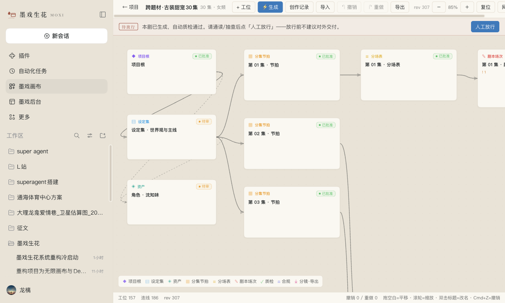
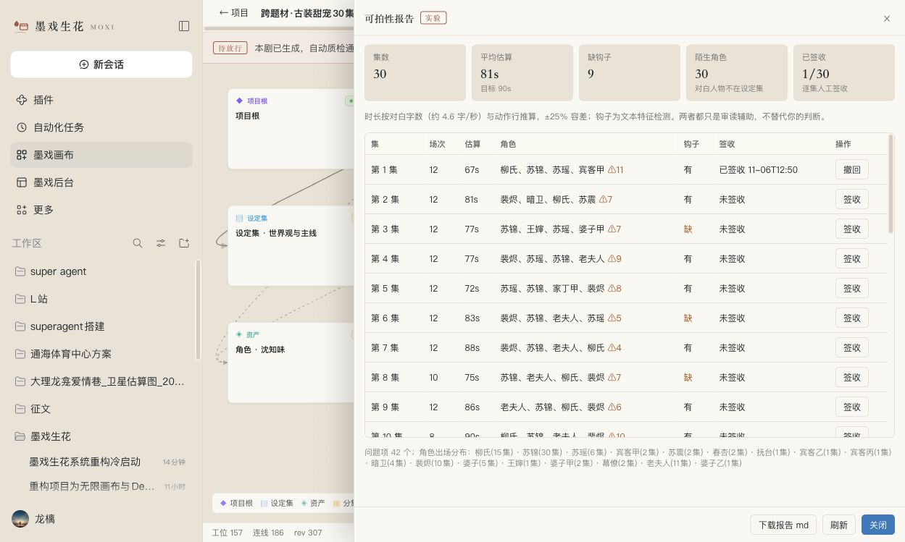
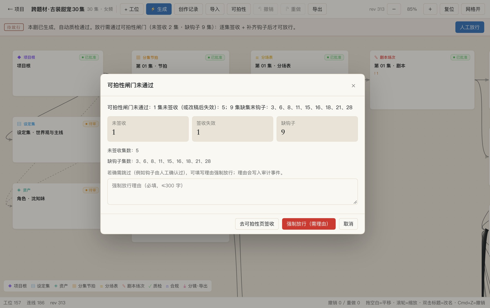

# 墨戏生花 · 短剧创作工作台（实验版）

> 一个跑在 [DeepSeek Harness](https://github.com/deepseek-ai/deepseek-harness) 上的短剧创作插件：
> **在无限画布上，把一部 30 集短剧从 idea 直接写到可导出 docx。**
> 本仓库只分发**安装包与文档**（闭源），不包含源码。


---

## 这是什么

墨戏生花把「写短剧」拆成一条可复跑的流水线，跑在本地：

```
新建剧作 → 概念设定 → 角色资产 → 分集节拍 → 分场表 → 剧本
        → 确定性检查（场景头/字数/场次/场号/集号）→ 合规红线 → 质检
        → 可拍性报告（时长/角色/钩子）→ 逐集签收 → 人工放行 → 导出 docx
```

- **无限画布**：每个节点就是一份稿子（设定集/角色/节拍/分场/剧本/质检/合规），拖拽、连线、双击改名
- **一键直出 30 集**：服务端任务化生成，进度抽屉实时看，可取消 / 续跑 / 断点恢复
- **可拍性证据**：逐集估算时长、场次、角色对白、集末钩子、是否在设定集内
- **逐集签收 + 放行闸门**：没签收、缺钩子 → 不允许放行；强制放行必须填理由并留审计
- **墨稿皮肤**：宣纸底、墨色字、朱砂点睛，跟随系统明暗，可一键切回宿主外观
- **管理后台**：KPI、项目表、规则扫描、模型探测、任务日志、按范围导出







---

## 下载

| 平台 | 文件 | 说明 |
|---|---|---|
| Windows 10/11 | [moxi-studio-exp-0.1.0-exp.5.zip](https://github.com/w1251788888-web/moxi-drama-studio/releases/download/v0.1.0-exp.5/moxi-studio-exp-0.1.0-exp.5.zip) | 推荐，系统自带解压 |
| macOS（Intel / Apple Silicon） | [moxi-studio-exp-0.1.0-exp.5.tar.gz](https://github.com/w1251788888-web/moxi-drama-studio/releases/download/v0.1.0-exp.5/moxi-studio-exp-0.1.0-exp.5.tar.gz) | 也可用 zip，内容一致 |
| Linux | 同上 tar.gz | 未正式验证，逻辑与 macOS 一致 |

> 版本：`0.1.0-exp.5`（实验版）· 全部版本见 [Releases](https://github.com/w1251788888-web/moxi-drama-studio/releases)

---

## 安装

### Windows

1. 下载 zip → 右键「全部解压缩」
2. 进入目录，**双击 `install-exp.cmd`**
   - 若提示「Windows 已保护你的电脑」→ 更多信息 → 仍要运行
   - 若 PowerShell 策略报错：在目录地址栏输入 `powershell` 回车，执行
     `powershell -ExecutionPolicy Bypass -File .\install-exp.ps1`
3. 装完桌面会出现 **「墨戏生花」快捷方式**，以后双击它启动（会自动打开浏览器）
4. 启动后左侧栏出现「墨戏画布」「墨戏后台」

> ⚠️ **不要**在 Win+R（运行框）里输入 `MOXI` / `墨戏生花` 启动——系统会把它当程序名去找，
> 弹 `Windows cannot find 'MOXI'`。正确方式只有：双击桌面「墨戏生花」快捷方式，或命令行 `dsh --profile moxi-exp`。

### macOS / Linux

```bash
tar xzf moxi-studio-exp-0.1.0-exp.5.tar.gz
cd moxi-studio-exp-0.1.0-exp.5
bash install-exp.sh
dsh --profile moxi-exp
```

### 前置条件

- 已安装 **DeepSeek Harness**，命令行里 `dsh --version` 能输出
- 可用的 **DeepSeek API 密钥**（或在 DSH 里登录账户）
- Python 3（仅用于导出 docx；没有时会降级为 md）

---

## 使用

1. 画布 →「+ 新开一部剧」，填剧名 / 集数 / 受众 / 题材 / 一句话故事
2. 点「⚡ 生成」选起止集（建议先 3 集试试），进度抽屉可看每集阶段
3. 生成完点「可拍性」：看逐集时长、角色、钩子，**逐集签收**
4. 点「人工放行」：未签收 / 缺钩子会被拦下，弹窗给出具体集号
5. 点「导出」拿到 docx（默认不含质检/合规报告，可勾选包含）

### 放行闸门（实验版默认开启）

| 拦截条件 | 说明 |
|---|---|
| 未签收 | 每集都要人工签收 |
| 签收失效 | 签收后改过稿，自动失效 |
| 缺集末钩子 | 检测不到悬念/反转/危机收尾 |

确需跳过：填理由「强制放行」，理由写入审计事件（`project.release.forced`）。
想关掉闸门：在 profile 配置里设 `releaseGateRequireSignoff: false` / `releaseGateRequireHook: false`。

---

## 常见问题

**Windows：弹出 `MOXI — Windows cannot find 'MOXI'`**
→ 你在运行框里输入了产品名。请双击桌面的「墨戏生花」快捷方式，或命令行 `dsh --profile moxi-exp`。

**提示找不到 `dsh`**
→ 先安装 DeepSeek Harness，并确认 `dsh --version` 在终端里能跑。

**导出变成 md 而不是 docx**
→ 本机没有可用的 python-docx；装 Python 3 + `pip install python-docx` 即可。

**装完没有快捷方式**
→ 手动双击安装目录里的 `start-moxi.cmd`；或命令行 `dsh --profile moxi-exp`。

**遇到其它问题**
→ 双击安装目录里的 `DIAGNOSE.bat`，把桌面生成的 `moxi-diagnose.txt` 贴到 Issues。

---

## 声明

- **本仓库仅分发安装包与文档，不含源码（闭源）。**
- **仅供学习、研究与个人创作参考使用，不可用于任何商业用途**（包括但不限于售卖、代运营、商业交付、付费课程、SaaS 转售）。
- 实验版软件，可能变更、损坏数据或停止维护；**使用前请自行备份**项目数据（`~/Documents/Moxi/projects`）。
- 生成内容由大模型产出，可能存在错误或不合规风险；**发布前请自行完成内容审核与合规审查**，因使用本软件产生的任何后果由使用者自行承担。
- 不得移除本声明与许可声明后再分发；转载请注明出处。
- 依赖的 DeepSeek Harness 及其组件遵循其各自许可证；本仓库不包含 DSH 本体。

完整条款见 [LICENSE](LICENSE)。

---

## 反馈

欢迎提 [Issue](/issues)：
- 报 Bug 请附：系统版本、`dsh --version`、`moxi-diagnose.txt`、复现步骤
- 提需求请说明使用场景（写什么题材、多少集、卡在哪一步）
- 不接受：商业定制、源码索取、绕过闸门的批量刷量脚本

---

## 联系我

扫码添加微信（请备注来意）：

<p align="center">
  
</p>

## 打赏

如果这个工具帮你省了时间，欢迎请我喝杯咖啡（**完全自愿，不影响任何功能使用**）：

<p align="center">
  
</p>
